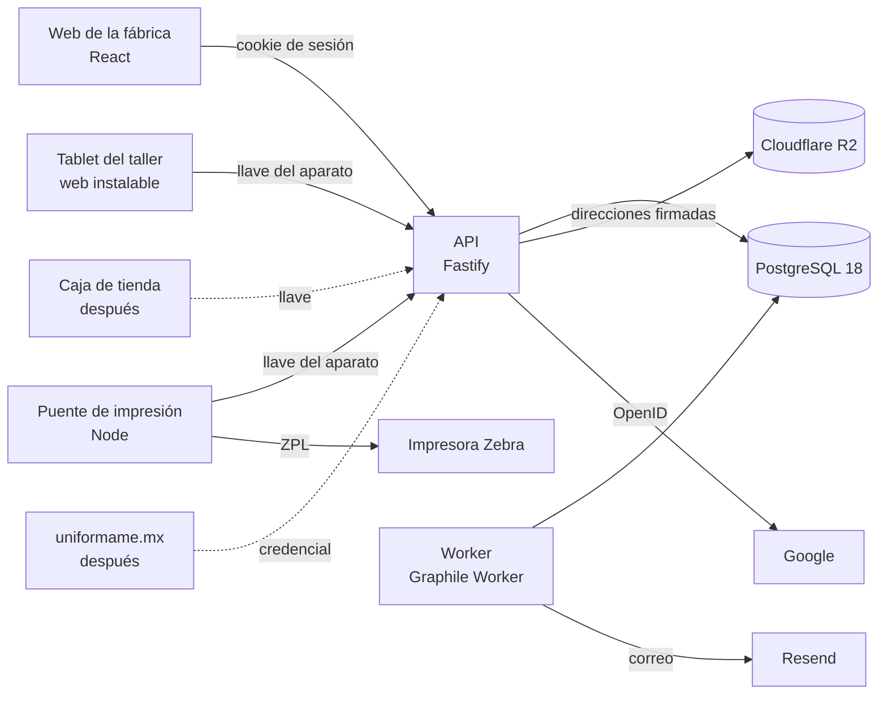

# Arquitectura

> **Qué cubre:** las piezas de Unifórmame y cómo hablan entre sí; el stack con su versión exacta y su documentación oficial; la librería de cada tarea; cómo corre todo en local.
> **Estado:** Decidido.
> **Se construye en:** [fase 1](../fases/01-repositorio-reglas-y-paquete-compartido.md).
> **Se conecta con:** [AGENTS.md](../../AGENTS.md) · [estructura](ESTRUCTURA.md) · [API](API.md) · [base de datos](BASE-DE-DATOS.md) · [eventos y trabajos](EVENTOS-Y-TRABAJOS.md) · [sincronización](SINCRONIZACION.md) · [infraestructura](INFRAESTRUCTURA.md) · [proyecto](../PROYECTO.md) · [archivos](../modulos/admin/archivos.md) · [sistema de diseño](../interfaz/DISENO.md) · [el puente de impresión](../apps/puente-de-impresion.md) · [la tablet del taller](../apps/tablet.md) · [etiquetas](../impresos/etiquetas.md) · [hojas](../impresos/hojas.md) · [seguridad](SEGURIDAD.md) · [forma de trabajo](../trabajo/FORMA-DE-TRABAJO.md)

## Las piezas

| Pieza | Qué hace | Dónde corre |
|---|---|---|
| **API** | Recibe todas las acciones y consultas, revisa permisos, escribe la base en una transacción por acción, sirve la sincronización de los aparatos y los avisos en vivo | Render, servicio web |
| **Worker** | Corre los trabajos programados, procesa la bandeja de eventos (avisos en vivo, avisos a personas, correo) y hace el respaldo semanal | Render, servicio en segundo plano |
| **PostgreSQL 18** | La única base de datos. Nunca se expone a internet: solo la API y el worker la tocan | Render, base administrada |
| **Web de la fábrica** | Las pantallas de los 15 departamentos. No guarda nada: necesita internet | Render, sitio estático |
| **Tablet del taller** | La Puerta del taller. Trabaja sin internet: guarda sus registros, fallas y consumibles y los sube cuando hay red | Tablet Android con Chrome, instalada como app web desde su sitio estático en Render |
| **Puente de impresión** | Programa chico en la computadora de Aduana y del taller: recibe los trabajos de impresión y manda el ZPL a la Zebra por la red local | Esa computadora |
| **Caja de tienda** (después) | El POS: Electron con SQLite, trabaja sin internet y sincroniza con la API | Computadora de cada tienda |
| **uniformame.mx** (después) | La tienda en línea. Habla con la API con una credencial de servidor de alcance limitado | Su propio servidor |

Servicios de fuera: **Google** (entrar con la cuenta de Google), **Cloudflare R2** (archivos y respaldo semanal), **Resend** (correo) y **Cloudflare DNS** (el dominio). Cómo se contratan y cuánto cuestan está en [infraestructura](INFRAESTRUCTURA.md).

## Cómo hablan

- **Web → API:** HTTPS con JSON. La sesión va en una cookie httpOnly; la web y la API viven en dos subdominios del mismo dominio, así que la cookie viaja como del mismo sitio. El protocolo completo está en [API](API.md).
- **Aparatos → API:** cada llamada lleva la llave del aparato. La tablet sube su cola y baja sus cambios con la [sincronización](SINCRONIZACION.md).
- **Avisos en vivo:** la API mantiene una conexión de eventos del servidor (SSE) con cada pantalla y cada aparato. Entre las instancias de la API y el worker, los eventos se reparten con `LISTEN/NOTIFY` de Postgres. Ver [eventos y trabajos](EVENTOS-Y-TRABAJOS.md).
- **Archivos:** la API da una dirección firmada que vence y el cliente sube o baja directo de R2. El almacenamiento nunca se expone. Ver [archivos](../modulos/admin/archivos.md).
- **Un solo contrato:** las formas de entrada y salida de cada acción se escriben una vez en Zod, en el [paquete compartido](PAQUETE-COMPARTIDO.md). De ahí salen la validación de la API, la de las pantallas, el cliente con tipos y la documentación OpenAPI.

## El stack

Versiones exactas al 9 de noviembre de 2026. Se instalan fijas (sin `^`); cambiar una versión es una decisión que se anota. Antes de usar cualquiera se lee su documentación oficial actual. Node y pnpm, además, los deja el script del entorno de la nube: si cambia su versión aquí, ese script cambia en el mismo commit (ver [el entorno de la nube](../trabajo/FORMA-DE-TRABAJO.md#el-entorno-de-la-nube)).

### Base

| Para qué | Herramienta | Versión | Documentación oficial |
|---|---|---|---|
| Correr JavaScript y TypeScript | Node.js (LTS) | 26.13.0 | https://nodejs.org/docs/latest-v26.x/api/ |
| Monorepo y paquetes | pnpm (workspaces) | 12.18.0 | https://pnpm.io/ |
| Tipos | TypeScript | 7.0.2 | https://www.typescriptlang.org/docs/ |
| Tipos de Node para TypeScript (`node:fs`, `node:child_process`…) | `@types/node` | 26.6.6 | https://github.com/DefinitelyTyped/DefinitelyTyped/tree/master/types/node |
| Estilo y errores comunes | Biome | 2.6.6 | https://biomejs.dev/ |
| Formas y validación | Zod | 4.6.7 | https://zod.dev/ |
| Fechas y horas | Temporal, con `temporal-polyfill` | 1.0.8 | https://tc39.es/proposal-temporal/docs/ |
| Identificadores v7 | uuid | 14.0.3 | https://github.com/uuidjs/uuid |

TypeScript 7 es el compilador nativo. Se usa solo para revisar tipos (`tsc --noEmit`): ninguna herramienta del stack depende de su API de JavaScript, y las dependencias que lo piden como opcional (MSW, `>=5.9`) lo aceptan. La API corre el TypeScript tal cual con Node, que quita los tipos al cargar, así que el código usa solo sintaxis que se puede borrar (`erasableSyntaxOnly`): nada de `enum` ni `namespace`.

### API y worker

| Para qué | Librería | Versión | Documentación oficial |
|---|---|---|---|
| Servidor HTTP | Fastify | 5.12.8 | https://fastify.dev/docs/latest/ |
| Contratos Zod en las rutas | fastify-type-provider-zod | 7.0.0 | https://github.com/turkerdev/fastify-type-provider-zod |
| OpenAPI desde los contratos | @fastify/swagger | 9.9.3 | https://github.com/fastify/fastify-swagger |
| Documentación navegable de la API (solo en local) | @scalar/fastify-api-reference | 1.77.0 | https://github.com/scalar/scalar |
| Cookies · CORS · encabezados de seguridad · límite de peticiones | @fastify/cookie · @fastify/cors · @fastify/helmet · @fastify/rate-limit | 11.1.5 · 11.4.1 · 13.2.0 · 11.2.2 | https://github.com/fastify |
| Base de datos | Drizzle ORM (`drizzle-orm`) · drizzle-kit | 0.45.4 · 0.31.11 | https://orm.drizzle.team/docs/overview |
| Conexión a Postgres | pg (node-postgres) | 8.23.1 | https://node-postgres.com/ |
| Tipos de pg para TypeScript | `@types/pg` | 8.23.1 | https://github.com/DefinitelyTyped/DefinitelyTyped/tree/master/types/pg |
| Base de datos | PostgreSQL | 18 | https://www.postgresql.org/docs/18/ |
| Trabajos y colas | Graphile Worker (`graphile-worker`) | 0.18.0 | https://worker.graphile.org/ |
| Entrar con Google | openid-client | 6.8.9 | https://github.com/panva/openid-client |
| Registro técnico | pino | 10.4.0 | https://getpino.io/ |
| Hash de llaves, PIN y cifrado | `node:crypto` (SHA-256, Argon2id, AES-256-GCM) | la de Node | https://nodejs.org/docs/latest-v26.x/api/crypto.html |

### Pantallas

| Para qué | Librería | Versión | Documentación oficial |
|---|---|---|---|
| Interfaz | React · react-dom | 19.3.1 | https://react.dev/ |
| Tipos de React para TypeScript | `@types/react` · `@types/react-dom` | 19.3.0 | https://github.com/DefinitelyTyped/DefinitelyTyped/tree/master/types/react |
| Empaquetar y servidor de desarrollo | Vite · @vitejs/plugin-react | 8.3.6 · 6.3.0 | https://vite.dev/ |
| Rutas, con pestañas y filtros en la dirección | @tanstack/react-router · @tanstack/router-plugin | 1.170.46 · 1.169.0 | https://tanstack.com/router/latest |
| Datos del servidor | @tanstack/react-query | 5.107.1 | https://tanstack.com/query/latest |
| Tablas densas | @tanstack/react-table | 9.3.1 | https://tanstack.com/table/latest |
| Listas largas | @tanstack/react-virtual | 3.14.26 | https://tanstack.com/virtual/latest |
| Estilos | Tailwind CSS · @tailwindcss/vite | 4.3.5 | https://tailwindcss.com/docs |
| Componentes | shadcn/ui sobre Base UI (@base-ui/react) | 4.23.0 · 1.9.0 | https://ui.shadcn.com/docs · https://base-ui.com/ |
| Íconos | lucide-react | 1.70.0 | https://lucide.dev/ |
| Formularios | react-hook-form · @hookform/resolvers | 7.91.0 · 7.0.5 | https://react-hook-form.com/ |
| Gráficas | Recharts | 3.10.1 | https://recharts.org/ |

### Tablet

| Para qué | Librería | Versión | Documentación oficial |
|---|---|---|---|
| Guardar sin internet | Dexie (IndexedDB) | 4.4.7 | https://dexie.org/docs/ |
| Instalable y sin red | vite-plugin-pwa | 2.0.0 | https://vite-pwa-org.netlify.app/ |
| Leer códigos con la cámara | BarcodeDetector del navegador, con el polyfill `barcode-detector` | 3.2.3 | https://developer.mozilla.org/en-US/docs/Web/API/Barcode_Detection_API |
| Revisar el PIN sin internet (Argon2id) | hash-wasm | 4.13.0 | https://github.com/Daninet/hash-wasm |

### Puente de impresión

| Para qué | Librería | Versión | Documentación oficial |
|---|---|---|---|
| Un solo ejecutable para Windows y Linux | Single executable applications de Node | La de Node | https://nodejs.org/api/single-executable-applications.html |
| Hablar con la Zebra | `node:net` (TCP al puerto 9100) y `~HS` de ZPL | La de Node | https://nodejs.org/api/net.html · Guía de programación ZPL II de Zebra |

### Documentos, correo y archivos

| Para qué | Librería | Versión | Documentación oficial |
|---|---|---|---|
| PDF de hojas y etiquetas | @react-pdf/renderer | 4.9.0 | https://react-pdf.org/ |
| Código de barras en el PDF | bwip-js | 4.11.4 | https://github.com/metafloor/bwip-js |
| Etiquetas en la Zebra | ZPL (Code 128 lo hace la impresora) | — | Guía de programación ZPL II de Zebra |
| Exportar a Excel | ExcelJS | 4.4.0 | https://github.com/exceljs/exceljs |
| Correo | Resend · @react-email/html · @react-email/head · @react-email/body · @react-email/container · @react-email/text · @react-email/button · @react-email/preview · @react-email/hr | 6.37.0 · 0.0.12 · 0.0.13 · 0.3.0 · 0.0.16 · 0.1.6 · 0.2.1 · 0.0.14 · 0.0.12 | https://resend.com/docs · https://react.email/docs |
| Archivos en R2 | @aws-sdk/client-s3 · @aws-sdk/s3-request-presigner | 3.1164.0 | https://developers.cloudflare.com/r2/ |

### Pruebas

| Para qué | Librería | Versión | Documentación oficial |
|---|---|---|---|
| Pruebas | Vitest | 5.1.0 | https://vitest.dev/ |
| Postgres real en las pruebas | testcontainers · @testcontainers/postgresql | 12.2.1 | https://node.testcontainers.org/ |
| Simuladores de Google, correo y almacenamiento | MSW | 3.0.4 | https://mswjs.io/ |
| Google de desarrollo para `pnpm local` | oidc-provider | 9.13.3 | https://github.com/panva/node-oidc-provider |
| Pruebas con datos al azar | fast-check | 4.10.2 | https://fast-check.dev/ |
| Pruebas en el navegador y capturas | @playwright/test | 1.65.0 | https://playwright.dev/ |

Cómo se usa cada una está en [pruebas](PRUEBAS.md).

## La librería de cada tarea

Antes de escribir código para algo de esta lista, se usa su herramienta. Lo que no está aquí sigue la escalera de la [regla de código](../../.claude/rules/codigo.md).

| Tarea | Con qué |
|---|---|
| Validar cualquier entrada | El contrato Zod del paquete compartido |
| Sumar, redondear y mostrar dinero | Las funciones de dinero del [paquete compartido](PAQUETE-COMPARTIDO.md) e `Intl.NumberFormat` |
| Día de negocio, semanas y horarios | Temporal, con la zona `America/Mexico_City`, desde el paquete compartido |
| Tablas y migraciones | Drizzle y drizzle-kit |
| Algo que pasa después de la acción o a una hora | Graphile Worker, desde el worker |
| Avisar a las pantallas en vivo | La conexión de eventos (SSE) de la API |
| Hojas para imprimir | React-PDF, en la API |
| Etiquetas | ZPL para la Zebra; PDF con React-PDF y bwip-js cuando no hay puente |
| Exportar | ExcelJS |
| Correo | Resend, con plantillas de React Email |
| Fotos y comprobantes | R2, con direcciones firmadas |
| Leer un código de barras | BarcodeDetector |
| Formularios | React Hook Form con el resolvedor de Zod |
| Tablas en pantalla | TanStack Table, con TanStack Virtual si son largas |
| Gráficas | Recharts |

## Cómo corre en local

Todo se construye y se prueba en local hasta la puesta en marcha (fase 23). «En local» es la máquina donde corre la sesión de Claude Code: la de la nube por ahora y la Mac de Bruno después (ver [dónde se trabaja](../trabajo/FORMA-DE-TRABAJO.md#dónde-se-trabaja)).

- **Un solo comando:** `pnpm local` levanta Postgres en Docker, aplica las migraciones, y arranca la API, el worker y la web con recarga al guardar. Los comandos están en [estructura](ESTRUCTURA.md#comandos).
- **Datos de la muestra:** `pnpm base:sembrar` carga los datos de la muestra (Instituto Juan Pablo II, PE-0145, L-2026-122…), para que cada pantalla se vea como en la muestra.
- **Servicios de fuera:** cada uno tiene su simulador sobre su interfaz oficial: Google en [acceso con Google](../modulos/admin/acceso-con-google.md), el correo en [avisos](../modulos/admin/avisos.md) y el almacenamiento en [archivos](../modulos/admin/archivos.md). Lo que solo se puede comprobar con el servicio real va a «Verificación real pendiente» de `REGISTROS.md`.
- **Variables de entorno:** en `.env`, que nunca entra a git; `.env.ejemplo` dice cuáles hay y para qué, sin valores reales. Se leen en un solo lugar al arrancar (ver [seguridad](SEGURIDAD.md)).

## Cómo está hecho

**Fase 1 · el monorepo y sus herramientas.**

- **Las versiones fijas** viven en el `package.json` de cada proyecto, sin `^` ni `~`. El `package.json` raíz fija pnpm con `packageManager: "pnpm@12.18.0"` y Node con `engines.node: "26.13.0"`; `pnpm-workspace.yaml` pone `engineStrict: true` (otro Node detiene la instalación) y `saveExact: true`. El lockfile registra también la versión de pnpm.
- **La prueba que lo vigila:** `scripts/versiones.prueba.ts` lee las tablas de [el stack](#el-stack) de este archivo, la única fuente de las versiones, y falla si una dependencia de cualquier `package.json` lleva rango o no es la de la tabla, si el lockfile instaló otra, o si el script de [el entorno de la nube](../trabajo/FORMA-DE-TRABAJO.md#el-entorno-de-la-nube) pide otro Node u otro pnpm. Una librería nueva entra primero a la tabla.
- **TypeScript:** `tsconfig.base.json` es estricto (`strict`, `noUncheckedIndexedAccess`, `exactOptionalPropertyTypes`, sin locales ni parámetros sin usar) y solo acepta sintaxis borrable (`erasableSyntaxOnly`, `verbatimModuleSyntax`, `allowImportingTsExtensions`): los imports llevan `.ts` y Node corre el archivo tal cual. `tsconfig.json` de la raíz lo extiende para los scripts y los paquetes, con los tipos de Node; `pnpm tipos` corre `tsc` sin emitir.
- **Biome** (`biome.json`): el preset recomendado, con `noExplicitAny` y `noNonNullAssertion` como error, sangría con tabuladores y comillas dobles. Revisa el código y la configuración; los `.md` los revisa `pnpm docs:revisar`, y la muestra visual no se toca.
- **Vitest** (`vitest.config.ts`): una sola configuración para el monorepo, que toma los `*.prueba.ts` y `*.prueba.tsx` junto a su código, en sus proyectos (ver [pruebas](PRUEBAS.md#cómo-está-hecho)).
- **`.env.ejemplo`** lista las variables de [infraestructura](INFRAESTRUCTURA.md#las-variables-de-entorno), sin valores; `.gitignore` deja fuera `.env`, `.revision/`, `.claude/worktrees/`, `.claude/estado/` y `node_modules/`.

**`pnpm local`** (fase 2): `apps/api/src/nucleo/base/local.ts` lee `.env` (con `ENTORNO=local`), levanta el servicio `base` de `compose.yaml` (Postgres 18, solo en `127.0.0.1:5432`, con el rol dueño `uniformame_dueno` y la base `uniformame`), aplica las migraciones y la siembra con `BASE_DATOS_URL_DUENO`, y le da entrada al rol `uniformame_app` con la clave que trae `BASE_DATOS_URL`. En `.env` van esas dos direcciones con su usuario, su clave y la base `uniformame` en `localhost`, y los tres dominios (`DOMINIO_WEB`, `DOMINIO_TALLER` y `DOMINIO_API`, por ejemplo `http://localhost:5173`, `http://localhost:5174` y `http://localhost:3000`), que la API pide desde la fase 3. Cada fase que suma una pieza (la API, el worker, la web, la tablet) la arranca aquí.
